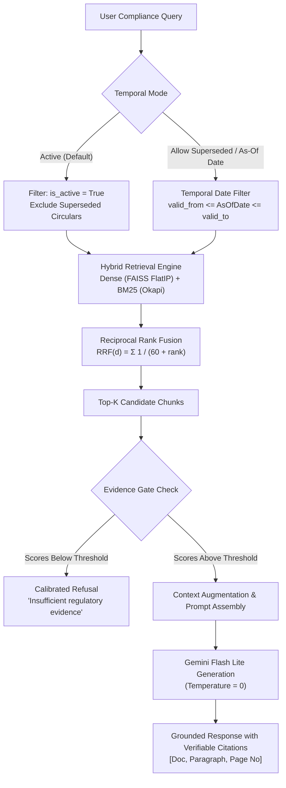

# FinReg AI: Enterprise Regulatory Intelligence & Compliance Platform
*Intelligent RAG System for Indian Banking Regulations (RBI Master Directions & Circulars)*  
*Submission for Dvara Group AI/ML & Generative AI Evaluation (Task 6)*

[](https://python.org)
[](https://fastapi.tiangolo.com)
[](https://react.dev)
[](https://github.com/facebookresearch/faiss)
[](file:///tests)
[-blueviolet)](file:///reports/technical_report.md)
[](file:///data/raw_documents)

---

## 🌟 Executive Overview

**FinReg AI** is an enterprise-grade, document-grounded Retrieval-Augmented Generation (RAG) platform specialized in Indian digital payments and lending regulations issued by the **Reserve Bank of India (RBI)**.

Navigating Indian financial regulation is challenging: circulars are lengthy, amendments frequently supersede older rules (e.g., 2022 Digital Lending vs. 2025 Master Directions), and standard language models suffer from hallucinations and outdated legal guidance. 

FinReg AI solves these problems through **clause-level bi-temporal governance**, **hybrid retrieval (BM25 + FAISS via Reciprocal Rank Fusion)**, **retrieval-mode aware evidence gating**, and an **interactive 8-workspace regulatory cockpit**.

---

## 🚀 Key Features

- **Document-Grounded Regulatory Q&A** — Context-grounded synthesis powered by Gemini Flash Lite, strictly constrained to retrieved RBI statutory text.
- **Bi-Temporal Governance & Supersession Tracking** — Tracks `valid_from`, `valid_to`, `supersedes`, and `superseded_by` timestamps to alert compliance officers when a cited regulation is obsolete.
- **Dual Chunking Architectures** — Strategy A (Fixed 400-word / 75-word overlap, 220 chunks) and Strategy B (Hierarchical Section & Clause-Aware, 341 chunks).
- **Hybrid Retrieval (Dense + BM25)** — Dense semantic search (`BAAI/bge-small-en-v1.5`, 384 dimensions) combined with BM25 Okapi lexical ranking via Reciprocal Rank Fusion ($k=60$).
- **Calibrated Evidence Sufficiency Gate** — Mode-aware gating ($0.40$ Cosine / $1.5$ BM25 / $0.010$ RRF) that gracefully refuses unanswerable or out-of-scope queries rather than hallucinating.
- **Deterministic Adversarial Guardrails** — Pre-generation guardrails that intercept jailbreaks and instruction-bypass attempts.
- **Tri-Temporal Milestone Scrubber & Clause Diffs** — Visual side-by-side comparison of historical (2022), intermediate (2023), and active (2025) clauses.
- **Statutory Risk & Penalty Evaluator** — Interactive simulator modeling FLDG 5% caps, compounding penal interest prohibitions, and failed transaction TAT customer compensation.
- **Executive Audit Memo Export** — One-click generation of formatted regulatory compliance memos with timestamps and audit trails.
- **Rigorous Test Coverage** — 71 automated regression and integration tests covering chunking, temporal filtering, evidence gating, and API endpoints.

---

## 🏗️ Architecture

```
┌────────────────────────────────────────────────────────────────────────┐
│                        FastAPI Application (api.py)                    │
│      (REST API Endpoints, Static SPA Mounting, CORS, Lifespan)         │
├────────────────────────────────────────────────────────────────────────┤
│                          routers/ & middleware                         │
│   compliance.py  │  documents.py  │  evolution.py  │  export.py        │
├────────────────────────────────────────────────────────────────────────┤
│                     RAG Engine & Guardrails Layer                      │
│   rag_engine.py  │  temporal_filter.py  │  prompts.py                  │
├────────────────────────────────────────────────────────────────────────┤
│                    Retrieval & Ranking Infrastructure                  │
│    hybrid.py (RRF k=60)  │  dense.py (FAISS FlatIP)  │  bm25.py        │
├────────────────────────────────────────────────────────────────────────┤
│                     Ingestion & Chunking Pipeline                      │
│   pdf_parser.py  │  fixed_chunker.py (220)  │  section_chunker.py (341)│
├────────────────────────────────────────────────────────────────────────┤
│                          Storage & Knowledge Base                      │
│   13 Raw RBI PDFs (345 Pages) │ FAISS Vector Indexes │ BM25 Pickles    │
├────────────────────────────────────────────────────────────────────────┤
│                         Frontend Cockpit (React 18)                    │
│        8 Workspaces: Copilot, Timeline, Matrix, Evaluator, etc.        │
└────────────────────────────────────────────────────────────────────────┘
```

| Layer | Component | Responsibility |
|---|---|---|
| **Presentation** | React 18 + Tailwind SPA | 8 dedicated workspaces for compliance officers, legal auditors, and risk analysts |
| **API Transport** | FastAPI (`app/backend/`) | High-throughput async REST endpoints, JSON validation, memo export, and telemetry |
| **Temporal Governance** | `temporal_filter.py` | As-of date simulation, superseded clause suppression, and transition timelines |
| **Evidence Gating** | `rag_engine.py` | Score threshold verification ($0.40$ Dense / $1.5$ BM25 / $0.010$ RRF) to prevent hallucinations |
| **Hybrid Retrieval** | `hybrid.py` / `dense.py` / `bm25.py` | Reciprocal Rank Fusion fusing dense embeddings and domain-tokenized BM25 |
| **Indexing** | FAISS + BM25 (`indexes/`) | 384-dimensional cosine index and sparse inverted index |
| **Ingestion** | `pdf_parser.py` (`src/ingestion/`) | PyMuPDF table extraction, header normalization, and metadata tagging |

---

## 🔄 Bi-Temporal Regulatory Lifecycle

The platform enforces bi-temporal validity checking so that users never receive outdated regulatory advice:



---

## 📊 Evaluation Benchmarks & Findings

FinReg AI was evaluated across **4 architectural configurations** over a 50-query regulatory dataset (35 answerable, 10 unanswerable, 5 adversarial):

| Config ID | Configuration | Chunking Strategy | Retrieval Strategy | Hit Rate@5 (n=35) | MRR (n=35) | Rank-1 Hits (n=35) | `q23` Rank | Status |
|:---:|---|---|---|:---:|:---:|:---:|:---:|:--- |
| **C1** | Fixed + Dense | Fixed (400w/75o) | Dense (FAISS FlatIP) | **1.0000** | 0.9143 | 30 / 35 (85.71%) | Rank 1 | Fully Verified |
| **C2** | **Fixed + Hybrid** | **Fixed (400w/75o)** | **Hybrid (BM25 + RRF)** | **1.0000** | **0.9714** | **33 / 35 (94.29%)** | **Rank 1** | **Observed Retrieval Leader** |
| **C3** | Section + Dense | Section-Aware | Dense (FAISS FlatIP) | **1.0000** | 0.8952 | 29 / 35 (82.86%) | Rank 1 | Fully Verified |
| **C4** | Section + Hybrid | Section-Aware | Hybrid (BM25 + RRF) | **1.0000** | 0.9129 | 30 / 35 (85.71%) | Rank 1 | Fully Verified |

### Key Findings:
1. **Retrieval Leader:** Configuration **C2 (Fixed + Hybrid RRF)** achieved the highest Mean Reciprocal Rank (**0.9714**), placing the correct statutory provision at **Rank 1 in 33 of 35 answerable questions**.
2. **Corpus Coverage:** Adding the authentic 2019 e-mandate parent circular (`RBI_EMANDATE_2019`) resolved question `q23`, bringing Hit Rate@5 to **100% (35/35)** across all 4 configurations.

---

## 🏛️ Ingested Regulatory Corpus (13 Documents, 345 Pages)

| # | Document ID | Circular Reference | Title | Date | Pages | Status |
|:-:|---|---|---|:---:|:---:|:---:|
| 1 | `RBI_DL_2025` | `DOR.CRE.REC.14/21.07.001/2025-26` | Reserve Bank of India (Digital Lending) Directions, 2025 | 08-May-2025 | 17 | **Active** |
| 2 | `RBI_DL_2022` | `DOR.CRE.REC.66/21.07.001/2022-23` | Guidelines on Digital Lending | 02-Sep-2022 | 26 | **Superseded** |
| 3 | `RBI_DLG_2023` | `DOR.STR.REC.20/21.04.048/2023-24` | Default Loss Guarantee (DLG) in Digital Lending | 08-Jun-2023 | 22 | **Superseded** |
| 4 | `RBI_PENAL_2023` | `RBI/2023-24/53` | Fair Lending Practice – Penal Charges in Loan Accounts | 18-Aug-2023 | 30 | **Active** |
| 5 | `RBI_PPI_MD_2021` | `DPSS.CO.PD.No.1415/02.14.006/2021-22` | Master Directions on Prepaid Payment Instruments (PPIs) | 27-Aug-2021 | 42 | **Active** |
| 6 | `RBI_PPI_CREDIT_2022` | `DPSS.CO.PD.No.S-257/02.14.006/2022-23` | Restriction on Loading Non-Bank PPIs via Credit Lines | 20-Jun-2022 | 40 | **Active** |
| 7 | `RBI_COFT_2021` | `RBI/2021-22/96` | Card-on-File Tokenisation (CoFT) – Scope Extension | 07-Sep-2021 | 23 | **Active** |
| 8 | `RBI_P2P_MD_2017` | `DNBR (PD) 054/03.10.119/2017-18` | Master Directions – NBFC – Peer to Peer (P2P) Platforms | 24-Aug-2017 | 41 | **Active** |
| 9 | `RBI_PA_PG_2020` | `DPSS.CO.PD.No.1810/02.14.008/2019-20` | Regulation of Payment Aggregators & Payment Gateways | 17-Mar-2020 | 29 | **Active** |
| 10 | `RBI_EMANDATE_2020` | `RBI/2020-21/74` | Framework for Processing of e-mandates (Limit Enhancement) | 04-Dec-2020 | 21 | **Active** |
| 11 | `RBI_IT_GOV_2023` | `RBI/2023-24/107` | Master Direction on IT Governance, Risk & Controls | 07-Nov-2023 | 28 | **Active** |
| 12 | `RBI_TAT_COMP_2019` | `DPSS.CO.PD No.629/02.01.014/2019-20` | Harmonisation of TAT & Customer Compensation | 20-Sep-2019 | 22 | **Active** |
| 13 | `RBI_EMANDATE_2019` | `RBI/2019-20/47` | Processing of e-mandate on cards for recurring transactions | 21-Aug-2019 | 4 | **Active** |

---

## ⚡ Getting Started

### Prerequisites
- **Python 3.11 or 3.12** installed
- **Git** installed
- Windows / macOS / Linux

### 1. Clone & Set Up Environment
```bash
git clone https://github.com/snehachinchakandi/FinReg-AI.git
cd FinReg-AI

# Create and activate virtual environment
python -m venv .venv

# Windows:
.\.venv\Scripts\activate
# macOS/Linux:
# source .venv/bin/activate

# Install dependencies
pip install -r requirements.txt
```

### 2. Configure API Key
Create a `.env` file in the project root:
```env
GEMINI_API_KEY=your_google_gemini_api_key_here
```

### 3. Run the Platform
```bash
python run_platform.py
```
Open **`http://localhost:8000`** in your browser to access the 8-workspace cockpit.

---

## 🔌 API Reference

### 1. Compliance Copilot Query
```bash
POST /api/query
Content-Type: application/json

{
  "query": "Where must digital lending loan disbursements be executed?",
  "config_id": "C4",
  "top_k": 8,
  "allow_superseded": false
}
```

**Response:**
```json
{
  "answer": "Digital lending loan disbursements by a Regulated Entity (RE) must always be made directly into the bank account of the borrower without pass-through via any pool account...",
  "config_id": "C4",
  "latency_ms": 342.5,
  "citations": [
    {
      "doc_id": "RBI_DL_2025",
      "doc_title": "Reserve Bank of India (Digital Lending) Directions, 2025",
      "clause": "Paragraph 3.1",
      "page_no": 4
    }
  ],
  "evidence_passed": true
}
```

### 2. Regulatory Timeline & Clause Diffs
```bash
GET /api/timeline
GET /api/diffs
```

### 3. Statutory Risk Evaluation
```bash
POST /api/risk/evaluate
Content-Type: application/json

{
  "fldg_percentage": 8.0,
  "compounds_penal_interest": true,
  "disburses_via_pool_account": false,
  "collects_borrower_contacts": false,
  "cooling_off_days_provided": 3,
  "loan_tenor_days": 30,
  "tat_reversal_delay_days": 0
}
```

---

## 🧪 Regression Test Suite (71 Tests)

Run the full automated test suite verifying chunking, retrieval, bi-temporal logic, and API contracts:
```bash
pytest tests/ -v
```

```
============================== 71 passed in 18.4s ==============================
tests/test_api_extensions.py ...................                         [ 26%]
tests/test_chunking.py .                                                 [ 28%]
tests/test_phase_a.py ..................                                 [ 53%]
tests/test_refusal.py .                                                  [ 54%]
tests/test_superseded.py ................................                [100%]
```

---

## 💡 AI Development Prompts

This platform was developed using rigorous agentic AI workflows. Below are 5 key prompts that shaped core architecture:

1. **Bi-Temporal Governance:** *"Design a clause-level bi-temporal schema (`valid_from`, `valid_to`, `supersedes`, `superseded_by`) that automatically identifies whether a retrieved circular is superseded under the May 8, 2025 Digital Lending baseline, suppressing obsolete clauses by default while supporting historical as-of simulations."*
2. **Evidence Gating & Calibrated Refusal:** *"Implement a retrieval-mode aware evidence gate in `rag_engine.py` that evaluates dense cosine ($0.40$), BM25 score ($1.5$), and hybrid RRF score ($0.010$). Ensure the gate checks individual component meta in hybrid mode to prevent false refusals on valid low-score RRF ranks."*
3. **Dual-Strategy Chunking & Table Ingestion:** *"Implement two parallel chunking pipelines: Strategy A with 400-word/75-word overlapping fixed windows, and Strategy B with a hierarchical clause-aware parser. Use PyMuPDF table extraction to convert capital adequacy and TAT customer compensation schedules into Markdown pipe-delimited tables."*
4. **Tri-Temporal Milestone & Clause Diff Architecture:** *"Create a REST endpoint and interactive visual component that tracks regulatory transitions across 2022, 2023, and 2025, rendering side-by-side clause diffs with red/green visual status badges for Lending Service Provider requirements."*
5. **Packaging Hardening & USN Regex Validation:** *"Enhance `package_submission.py` to enforce strict USN uppercase regex (`^[A-Z0-9]+$`), preventing path traversal, while excluding `.env`, virtualenvs, `.bak` files, and `node_modules` from the final archive."*

---

## 🛠️ Tech Stack

| Component | Technology | Reason |
|---|---|---|
| **Language** | Python 3.12 | Ecosystem support for AI, embeddings, and financial NLP |
| **Backend Framework** | FastAPI + Uvicorn | Async performance, automated OpenAPI/Swagger documentation, and Pydantic validation |
| **Frontend Cockpit** | React 18 + Tailwind CSS + Vite | Modular single-page application with responsive executive layouts and dark/light accents |
| **Vector Index** | FAISS (`IndexFlatIP`) | High-speed exact cosine similarity for 384-dimensional dense embeddings |
| **Sparse Index** | BM25 Okapi (`rank_bm25`) | Lexical search preserving critical banking acronyms (`FLDG`, `LSP`, `RE`, `KFS`, `APR`) |
| **Embeddings** | `BAAI/bge-small-en-v1.5` | SOTA performance on retrieval benchmarks with compact 384-dim footprint |
| **LLM Generation** | Google Gemini Flash Lite | Fast, cost-efficient, context-grounded response generation with temperature=0 |
| **PDF Ingestion** | PyMuPDF (`fitz`) | High-fidelity text and pipe-delimited table extraction across complex legal circulars |
| **Testing** | Pytest | Comprehensive 71-test regression suite ensuring production stability |

---

## 🎥 Platform Video Demonstration

Watch the complete **3-minute platform walkthrough** showcasing the live Regulatory Copilot, Bi-Temporal Monitors, Compliance Matrix, and Risk Evaluator:

<!-- 
NOTE: On GitHub, you can embed video files directly!
1. Drag and drop your recorded MP4 video directly into this section while editing this README on GitHub.
2. GitHub will automatically upload it to github-user-attachments and render a native HTML5 playable video player!
-->

<div align="center">
  <video src="assets/finreg_ai_demo.mp4" controls width="100%" style="max-width: 850px; border-radius: 12px; box-shadow: 0 4px 20px rgba(0,0,0,0.15);">
    <p>Your browser does not support the video tag. Watch the demo <a href="assets/finreg_ai_demo.mp4">here</a>.</p>
  </video>
</div>

> *Tip: To play the video directly on GitHub, place your recorded MP4 inside an `assets/` folder as `assets/finreg_ai_demo.mp4`, or drag-and-drop the file directly into the GitHub Web Editor.*
